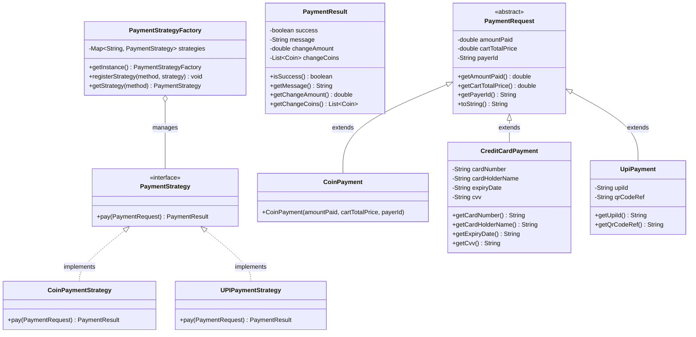
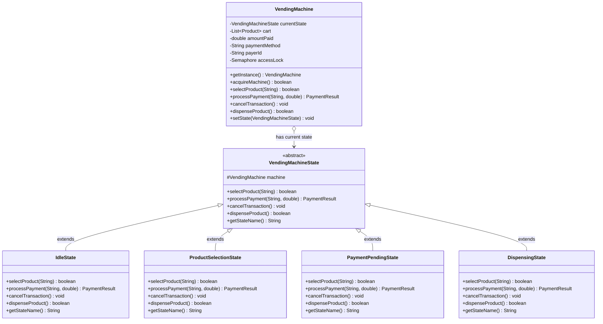
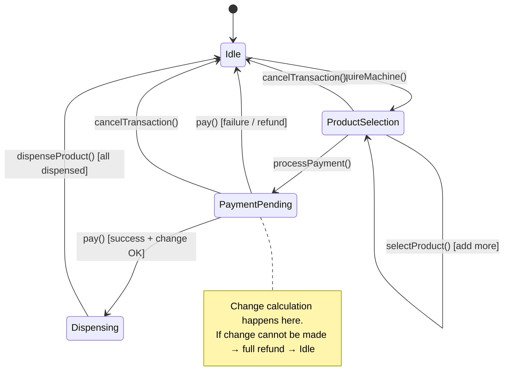
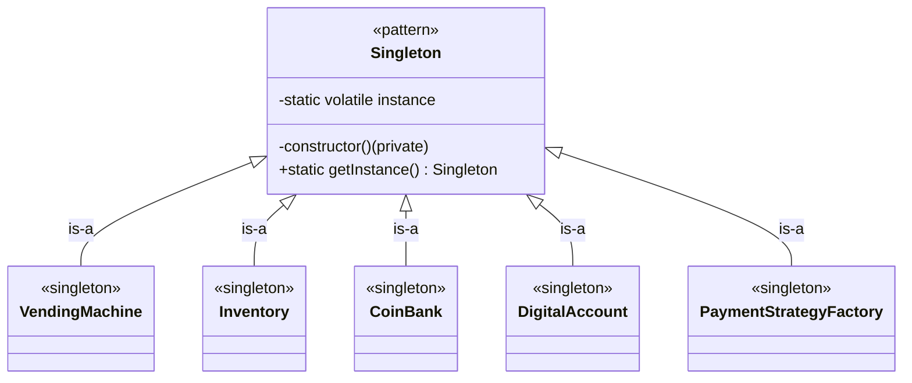
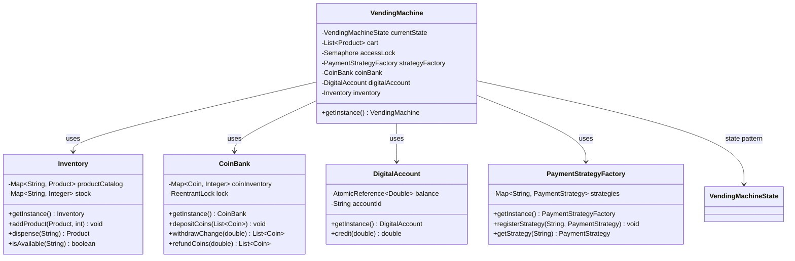

# Vending Machine — Architecture Documentation

## Overview

This document describes the architecture of the Vending Machine Low-Level Design project.
It covers all design patterns, class relationships, and component interactions.

---

## 1. Class Hierarchy — Design Patterns Used

| Pattern | Where | Purpose |
|---------|-------|---------|
| **Singleton** | `VendingMachine`, `Inventory`, `CoinBank`, `DigitalAccount`, `PaymentStrategyFactory` | Single instance for global state |
| **State** | `VendingMachineState` + 4 concrete states | Transaction lifecycle management |
| **Strategy** | `PaymentStrategy` + 2 concrete strategies | Pluggable payment algorithms |
| **Template Method** | `PaymentRequest` (abstract) + subclasses | Shared payment data structure |

---

## 2. Package Structure

```
com.rocky.vendingmachine
├── VendingMachineDemo.java       — Entry point & scenario runner
│
├── core/
│   └── VendingMachine.java       — Central controller (Singleton)
│
├── payment/
│   ├── PaymentStrategy.java      — Strategy interface
│   ├── CoinPaymentStrategy.java  — Coin payment implementation
│   ├── UPIPaymentStrategy.java   — UPI payment implementation
│   ├── PaymentStrategyFactory.java — Factory (Singleton, OCP-compliant)
│   ├── PaymentRequest.java       — Abstract base class for payment data
│   ├── CoinPayment.java          — Coin payment request
│   ├── CreditCardPayment.java    — Credit card payment request
│   └── UpiPayment.java           — UPI payment request
│
├── state/
│   ├── VendingMachineState.java  — Abstract state base class
│   ├── IdleState.java            — Machine available
│   ├── ProductSelectionState.java — User selecting products
│   ├── PaymentPendingState.java  — Processing payment
│   └── DispensingState.java      — Dispensing products
│
├── bank/
│   ├── CoinBank.java             — Coin inventory (Singleton, thread-safe)
│   └── DigitalAccount.java       — UPI wallet (Singleton, thread-safe)
│
├── inventory/
│   └── Inventory.java            — Product catalog & stock (Singleton, thread-safe)
│
└── model/
    ├── Product.java              — Product data model
    └── Coin.java                 — Coin enum (1, 2, 5, 10)
```

---

## 3. Class Diagrams

### 3.1 Payment Strategy Pattern



### 3.2 State Pattern



### 3.3 State Transitions



### 3.4 Singleton Pattern (used across the system)



### 3.5 Full System Overview



---

## 4. Open/Closed Principle Compliance

### Before (violation in `PaymentStrategyFactory`)
```java
// Factory had hardcoded constructor — needed modification for new payment types
private PaymentStrategyFactory() {
    strategies = new ConcurrentHashMap<>();
    registerStrategy("COIN", new CoinPaymentStrategy());  // hardcoded
    registerStrategy("UPI", new UPIPaymentStrategy());    // hardcoded
}
```

### After (fixed — moved registration to `VendingMachine`)
```java
// VendingMachine registers strategies externally
strategyFactory.registerStrategy("COIN", new CoinPaymentStrategy());
strategyFactory.registerStrategy("UPI", new UPIPaymentStrategy());

// To add a new payment type, just add ONE line here + new classes
strategyFactory.registerStrategy("CREDIT_CARD", new CreditCardPaymentStrategy());
```

The factory itself is now **closed for modification** — it only contains the generic registry logic.

---

## 5. Adding a New Payment Method

To add a new payment method (e.g. **NetBanking**), you need:

### Step 1: Create a Payment Request subclass

```java
public class NetBankingPayment extends PaymentRequest {
    private final String bankName;
    private final String accountNumber;

    public NetBankingPayment(double amountPaid, double cartTotalPrice,
                             String payerId, String bankName, String accountNumber) {
        super(amountPaid, cartTotalPrice, payerId);
        this.bankName = bankName;
        this.accountNumber = accountNumber;
    }
    // getters...
}
```

### Step 2: Create a Payment Strategy

```java
public class NetBankingPaymentStrategy implements PaymentStrategy {
    @Override
    public PaymentResult pay(PaymentRequest request) {
        NetBankingPayment nb = (NetBankingPayment) request;
        // process payment...
        return new PaymentResult(true, "Success via " + nb.getBankName(), 0, List.of());
    }
}
```

### Step 3: Register in `VendingMachine` constructor

```java
strategyFactory.registerStrategy("NET_BANKING", new NetBankingPaymentStrategy());
```

No existing code is modified — only new files are added.

---

## 6. Thread Safety

| Component | Mechanism |
|-----------|-----------|
| `VendingMachine` | `Semaphore(1)` — only one user at a time |
| `Inventory` | `ConcurrentHashMap` + `synchronized` for compound ops |
| `CoinBank` | `ReentrantLock` |
| `DigitalAccount` | `AtomicReference` + CAS loop |
| `PaymentStrategyFactory` | `ConcurrentHashMap` + double-checked locking for instance |
| Singletons | `volatile` + double-checked locking |

---

## 7. Data Flow — Typical Transaction

```
User                    VendingMachine              State              Strategy           Bank/Inventory
 |                            |                       |                    |                     |
 |-- acquireMachine() ------->|                       |                    |                     |
 |                            |-- setState(ProductSel)|                    |                     |
 |<-- true -------------------|                       |                    |                     |
 |                            |                       |                    |                     |
 |-- selectProduct("P01") --->|                       |                    |                     |
 |                            |-- state.selectProduct |                    |                     |
 |                            |<------- checks stock -|                    |                     |
 |<-- true -------------------|                       |                    |                     |
 |                            |                       |                    |                     |
 |-- processPayment(COIN,50)->|                       |                    |                     |
 |                            |-- state.processPay    |                    |                     |
 |                            |-- create CoinPayment -|                    |                     |
 |                            |-- deposit coins ----->|                    |------> CoinBank     |
 |                            |-- strategy.pay() ---->|                    |                     |
 |                            |                       |<-- validate -------|                     |
 |                            |                       |-- success + change |                     |
 |                            |-- withdrawChange ---->|                    |------> CoinBank     |
 |                            |-- setState(Dispense)  |                    |                     |
 |                            |-- dispenseAll() ----->|                    |------> Inventory    |
 |                            |-- setState(Idle)      |                    |                     |
 |                            |-- release semaphore   |                    |                     |
 |<-- PaymentResult ----------|                       |                    |                     |
```

---

*Generated for Vending Machine LLD project.*